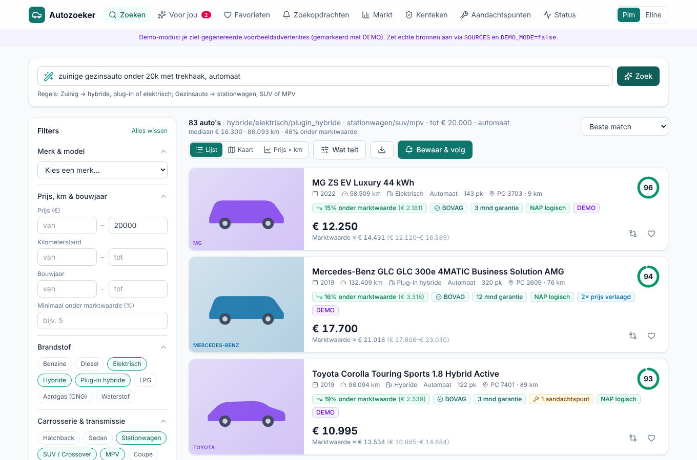
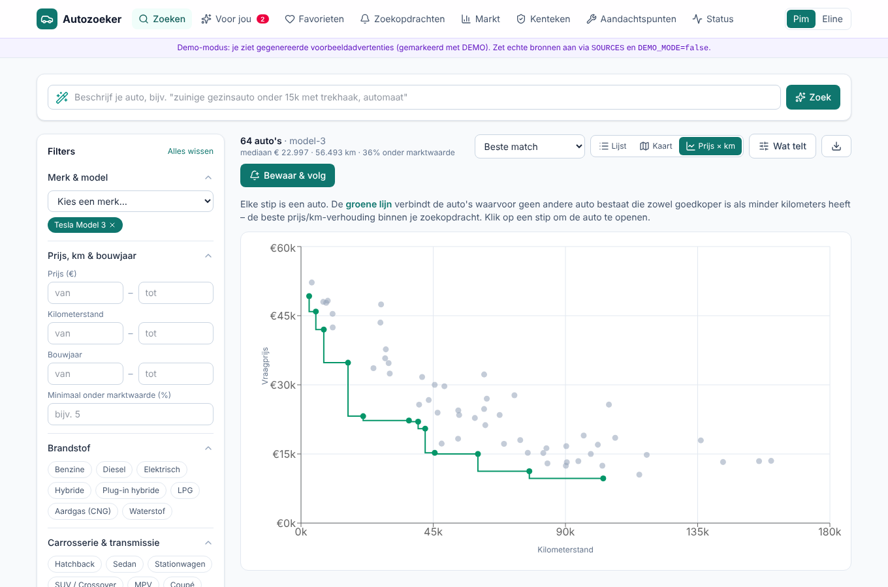
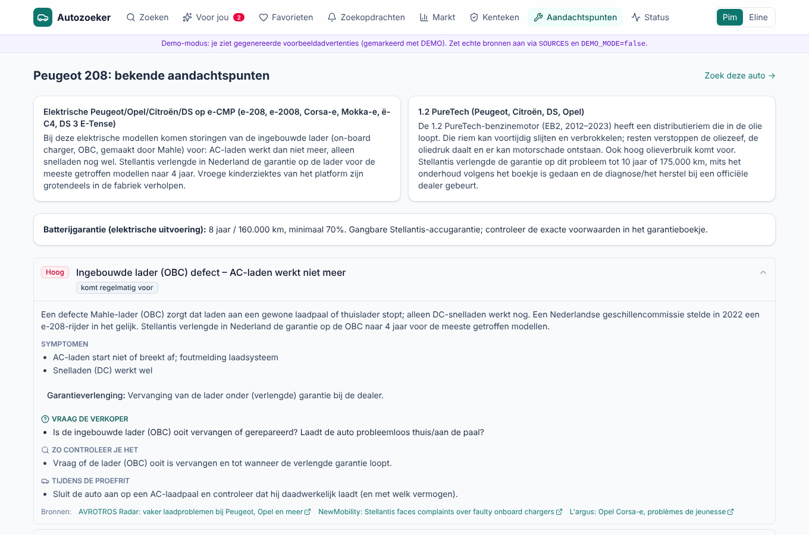
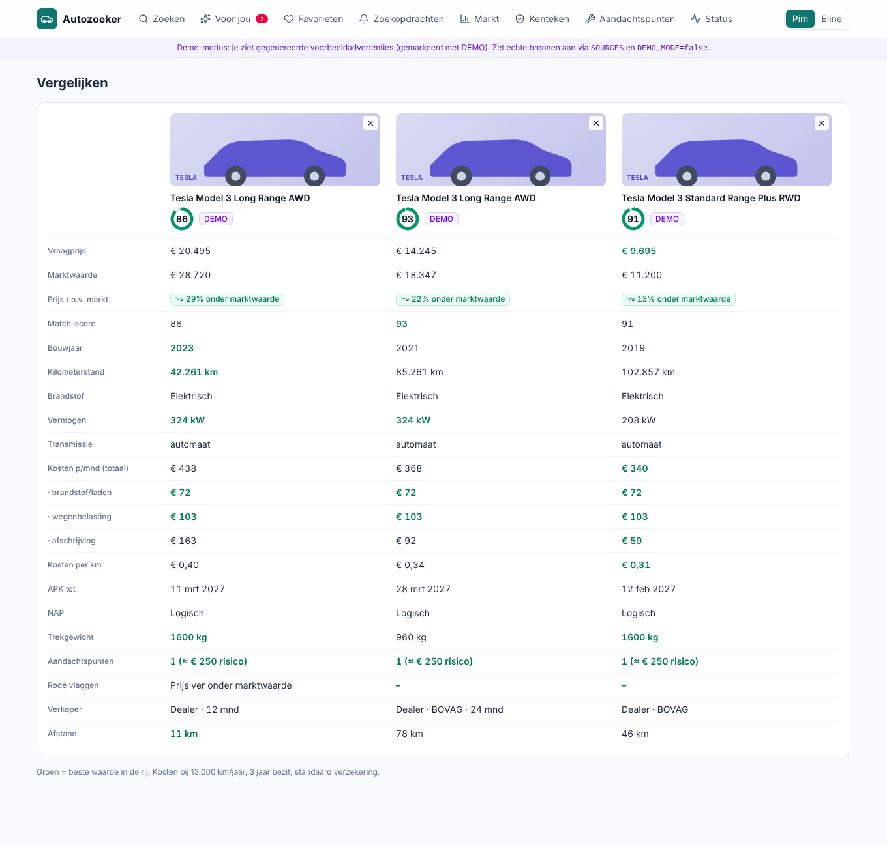
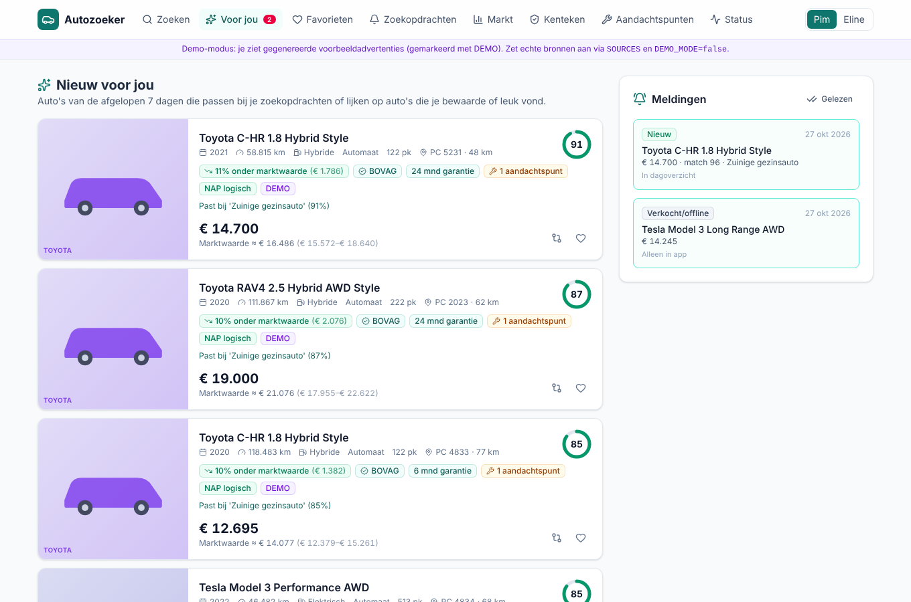
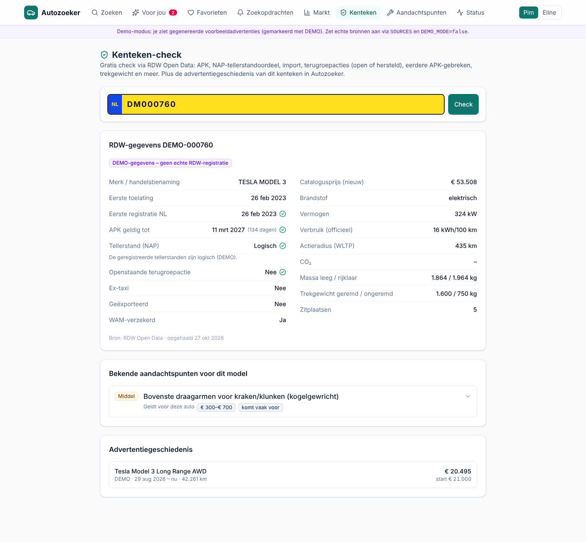
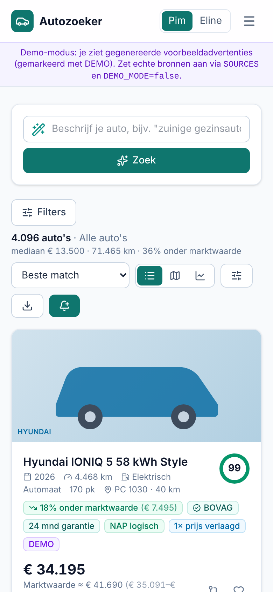

# Autozoeker

A self-hosted used-car search engine for the Dutch market. It collects listings and checks each car
against official RDW data. It estimates what the car is worth and lists the known defects of that
model, with the questions to ask the seller. New matches for your saved searches arrive as phone
notifications.

The UI is in Dutch (kenteken, APK, NAP and BOVAG don't translate well); code and docs are in English.

> **Status:** out of the box it runs on **5,000 generated demo listings** (clearly marked `DEMO`)
> with RDW-like demo data. The AutoScout24 and Marktplaats adapters are written but **unverified**:
> the network they were built on blocked those sites. See [Real listing sources](#real-listing-sources).



| | |
|---|---|
|  |  |
|  |  |
|  |  |

Full detail page: [docs/screenshots/04-tesla-detail.png](docs/screenshots/04-tesla-detail.png) ·
viewing checklist: [05-checklist.png](docs/screenshots/05-checklist.png) ·
market insights: [08-markt.png](docs/screenshots/08-markt.png)

## Features

### Search
- Filters: make/model/generation, body, fuel (incl. hybrid/PHEV), transmission, price, km, year,
  power, seats, colour, towing capacity, EV range, options (tow bar, heat pump, adaptive cruise …),
  minimum % under market value and distance from your postcode.
- Seller filters: dealer/private, BOVAG, warranty. You can also hide imports, illogical NAP, open
  recalls, serious red flags and battery-lease cars.
- **Natural-language search:** "zuinige gezinsauto onder 20k met trekhaak, automaat" becomes
  editable filters. A rule-based parser handles common phrases offline; with an API key Claude
  handles the rest.
- Sort by best match, deal, price (either way), km, year, newest or distance.
- Three views: list, map (Leaflet) and **price × km scatter with the Pareto frontier**. The frontier
  contains the cars for which no other car in the search is both cheaper and lower in km.
- CSV export of any result set (semicolon-separated, opens in Excel/Power BI).
- The same car on several sites is shown once: grouped by kenteken, otherwise by a fingerprint.

### What is it worth? Deal score and best match
- **Market value** from a gradient-boosting model on log(price). Features: age, km, power, battery,
  fuel, transmission, body, make/model/generation, trim level and options. It is retrained nightly
  on every listing seen, including sold ones.
  - Quantile models (p10/p90) give a value band.
  - Deal scores use out-of-fold predictions, so a car is never valued by a model that has seen its
    own price.
  - With too little data it falls back to a per-model regression, then to the median of the
    nearest comparables (labelled low confidence).
- **Km effect:** "this car has 15,968 km fewer than normal for its age; the market adds about €1,325
  for that". Value is constrained to never rise with km or age.
- **12 comparable cars** shown next to every valuation, including sold ones.
- **Best match (0–100):** a weighted composite with weights you set per profile ("Wat telt"):

  | Component | Default weight |
  |---|---|
  | Price vs market value | 35% |
  | RDW history: NAP, recalls, APK, import, taxi | 20% |
  | Km for its age | 15% |
  | Known issues: expected repair cost of unresolved issues | 15% |
  | Seller: dealer, BOVAG, warranty | 10% |
  | Distance | 5% |

  Red flags are subtracted from the composite. Thumbs up/down on cars nudge your weights through a
  small logistic regression ("Leer mijn voorkeur").

### Known issues (aandachtspunten)
- A **curated knowledge base**: 21 files and 42 issues covering the models and engines that are
  popular on the Dutch used market. Every issue has at least one source.
  - Tesla Model 3/Y upper control arms; Model S/X MCU (eMMC)
  - 1.2 PureTech timing belt in oil; VW DSG7 DQ200 mechatronic; 1.0/1.5 EcoBoost; Renault 1.2 TCe
  - Hyundai/Kia E-GMP ICCU; Kona Electric battery recall; Stellantis e-CMP onboard charger
  - Nissan Leaf degradation; Renault Zoe battery lease; Toyota hybrid catalytic-converter theft
  - BMW N47 timing chain, Mercedes M270 and 7G-DCT, Volvo Drive-E oil consumption, and more
- Each issue records:
  - which generations, years, fuels, gearboxes and engine codes it applies to
  - symptoms and repair-cost range
  - whether it was fixed, and how: recall, campaign, revised part, software, warranty extension
  - how to check that it was fixed, what to ask the seller, and what to test on the drive
- **Matched per car.** A DSG issue doesn't show on a manual car, and a PureTech issue doesn't show on
  an e-208. For recalls, the car's own RDW recall status ("herstel gemeld") answers the question "was
  it fixed?".
- **Models not in the base** can be researched by Claude with web search on demand (needs
  `ANTHROPIC_API_KEY`). Results use the same schema with sources, are labelled
  "AI-onderzocht — controleer bronnen" and are cached for 180 days. The curated base always takes
  precedence.
- **Viewing checklist** per car: printable and phone-friendly, with ticks saved on the watchlist. It
  covers documents to ask for, the model-specific checks, an EV battery block and an advice to get
  an inspection (aankoopkeuring).

### Saved searches, "Nieuw voor jou" and alerts
- Save any search. Every crawl cycle (default 30 min) checks new listings, price drops and cars back
  on the market against each saved search. Each match gets a **match %** (filters plus best-match
  score).
- Delivery per search: **instant**, **daily digest** (at `DIGEST_HOUR`) or off. Each search has its
  own minimum match % and price-drop threshold (€ and %).
- **ntfy push:** title, price, deal %, thumbnail, plus buttons that open the listing and the app.
  Each alert is sent once per car, kind and price.
- **Watchlist alerts:** price drops and "sold/offline" for cars you're following.
- **"Nieuw voor jou" feed:** saved-search matches from the last 7 days, plus cars similar to the
  ones you saved or liked.

### Per car
- **RDW report** (also as a standalone kenteken check):
  - first admission vs first NL registration (import detection), APK expiry with days left
  - NAP odometer verdict, open and resolved recalls
  - catalogue price, mass, consumption, WLTP range, towing capacity
  - ex-taxi, exported and insured status
  - earlier APK defects
- **Monthly cost** (TCO): fuel or charging from real-world consumption, road-tax estimate,
  maintenance, insurance and depreciation from the value model. Monthly and per km, with editable
  km/year, years owned, insurance, road tax and energy prices.
- **Negotiation helper:** opening offer and walk-away price, with arguments in Dutch. These are based
  on the market value, days online, earlier price drops, expected repair cost of open issues and
  APK due date.
- **Red flags:**
  - price more than 25% under market value
  - listing doesn't match RDW (year, make, fuel)
  - NAP illogical; import not mentioned in the ad
  - open recall; APK expiring soon; ex-taxi
  - phrases such as "export", "handelsprijs", "start niet", "schade"
  - the same kenteken relisted; a "private" seller with many ads; long time online
- **AI ad check** (optional, on demand): Claude reads the description for hidden signals and
  suggests extra questions.
- **EV block:**
  - remaining battery warranty (years/km)
  - summer, winter and motorway range estimates
  - heat pump, battery-lease detection

### Other
- **Compare** 2–4 cars side by side; the best value in each row is highlighted.
- **Watchlist pipeline:** Interessant → Gebeld → Bezichtiging → Proefrit → Bod → Gekocht/Afgevallen,
  with notes.
- **Market page** per model:
  - price distribution, median price by year and depreciation curve
  - km vs price, weekly supply, median days to sale, share with price drops
  - "beste deals vandaag"
- **Add by link:** paste an AutoScout24/Marktplaats link on the Favorieten page to add that car
  (depends on the unverified adapters).
- **Profiles** Pim and Eline: separate saved searches, weights, feedback and ntfy topics; the
  watchlist is shared.
- **Status page:** crawl runs per source, errors, model metrics, scheduler jobs.
- Has a web app manifest, so it can be added to a phone's home screen.

## Quick start (Docker)

```bash
git clone https://github.com/pietjeprecies123/autozoeker && cd autozoeker
cp .env.example .env          # optional; defaults run the demo
docker compose up -d --build
# open http://localhost:8000
```

On first start the app runs the database migrations and seeds 5,000 demo listings. It then trains
the value model; this takes about 30 seconds, and the UI shows a notice until it's ready. Data lives
in `./data` (SQLite). The image is about 1.2 GB, mostly scikit-learn, numpy and scipy.

## Development

Requirements: Python 3.11+ with [uv](https://docs.astral.sh/uv/), and Node 22.

```bash
make install        # uv sync + npm ci
make dev            # backend on :8000 (reload) + Vite on :5173 (proxies /api)
make test           # pytest + vitest
make lint typecheck # ruff + tsc
```

CLI (`cd backend && uv run python -m app.cli --help`):

| Command | What it does |
|---|---|
| `seed-demo --n 5000` | Load the demo listings (only into a database without them) and train |
| `crawl` | Run one crawl cycle now (sources → pipeline → alerts) |
| `retrain` | Retrain the value model and rescore all listings |
| `verify-sources` | Fetch one search page per real source and report what parsed |
| `capture <source>` | Save raw responses to `captures/` (for writing parser tests) |
| `research <make> <model>` | Research known issues with Claude and cache the result |

## Configuration

All settings are environment variables (see [`.env.example`](.env.example)); every one is optional.

| Variable | Default | Purpose |
|---|---|---|
| `SOURCES` | `demo` | Comma-separated: `demo`, `autoscout24`, `marktplaats` |
| `DEMO_MODE` | `true` | Seed demo data on an empty database |
| `CRAWL_INTERVAL_MIN` | `30` | Crawl cycle interval (±2 min jitter) |
| `CRAWL_REQUEST_DELAY_S` / `CRAWL_MAX_PAGES` | `4` / `3` | Politeness per source |
| `HOME_POSTCODE` | `3511` | Default for distances and the road-tax province; profiles can override |
| `APP_URL` | `http://localhost:8000` | Base for links in push notifications |
| `NTFY_SERVER` / `NTFY_TOPIC` / `NTFY_TOKEN` | `https://ntfy.sh` / – / – | Push notifications |
| `DIGEST_HOUR` | `8` | Hour of the daily digest (Europe/Amsterdam in Docker) |
| `ANTHROPIC_API_KEY` | – | Enables the Claude features |
| `CLAUDE_MODEL` | `claude-opus-5-5` | Model for the Claude features |
| `ISSUE_RESEARCH_TTL_DAYS` | `180` | Cache lifetime of AI-researched issues |
| `ONLINE_ENRICHMENT` | `true` | Call RDW and PDOK for real kentekens and postcodes |
| `RDW_APP_TOKEN` | – | Optional Socrata token for higher RDW rate limits |
| `BASIC_AUTH_USER` / `BASIC_AUTH_PASSWORD` | – | Require HTTP basic auth (everything except `/api/health`) |

**Phone access:** the simplest safe setup is [Tailscale](https://tailscale.com) on the server and the
phone, with `APP_URL` set to the Tailscale name. If you expose the app to the internet instead, set
basic auth and put it behind HTTPS.

## Real listing sources

`autoscout24` and `marktplaats` adapters exist (`backend/app/sources/`). They are **unverified**,
because the network they were developed on blocked both sites:
- The AutoScout24 adapter reads the `__NEXT_DATA__` JSON embedded in search and detail pages.
- The Marktplaats adapter calls the search endpoint the website itself uses.
- Their parsers are tested against *assumed* response shapes only.

To try them:

```bash
cd backend
uv run python -m app.cli verify-sources          # does anything parse?
uv run python -m app.cli capture autoscout24     # save raw pages to fix the parser against
SOURCES=demo,autoscout24,marktplaats uv run python -m app.cli crawl
```

Set `DEMO_MODE=false` and remove `demo` from `SOURCES` to stop using demo data. Demo rows already in
the database stay there (hidden from search by default); start from an empty `data/` directory to
drop them.

**What gets crawled:** only the make/model of each saved search and watched car, up to
`CRAWL_MAX_PAGES` pages. There is no price filter, so the value model gets comparables; the
saved-search filters are applied in the database.

**Politeness:**
- Requests are spaced `CRAWL_REQUEST_DELAY_S` apart and carry a clear User-Agent.
- On a 403/429 or a captcha page the source is paused: 1 hour, doubling with each repeat up to 24
  hours. The status page shows the pause.
- There is no evasion of anti-bot measures: no proxies, captcha solving or fingerprint spoofing.

**Sold detection:** a listing that searches haven't returned for 72 hours is re-checked on its own
advert page before it is marked sold. Up to 20 are checked per cycle, watched cars first, so a car
that dropped beyond the last crawled page doesn't trigger a false "sold" alert. One advert seen in
the current cycle must parse first; if it doesn't (for instance after a site changes its markup),
nothing is marked sold.

**Terms of use:** both sites' terms restrict automated collection. Scraping for personal use is a
grey area, and the adapters will break whenever a site changes its markup. Use them at your own
risk, keep the volume low, and don't republish the data.

## Claude API

Everything works without a key. With `ANTHROPIC_API_KEY` set:

| Feature | Call | Rough cost |
|---|---|---|
| Known-issues research for an uncovered model | `claude-opus-5-5`, web search (max 8 searches), structured result via a strict tool, effort `medium` | **Estimate:** €0.30–0.80 per model, once per 180 days. Actual tokens, searches and cost are stored and shown per research. |
| Natural-language search | structured output (JSON schema), effort `low` | ~€0.01 per query |
| AI ad check | structured output, effort `low` | ~€0.01–0.03 per car |

The research cost has not been measured: no API key was available while building, so the AI code is
tested against a stubbed client. Pricing used: $4/$20 per million input/output tokens and $10 per
1,000 web searches.

Requests use server-side refusal fallback (`fallbacks: "default"`). A refusal is reported in the UI
and never cached.

## Push notifications (ntfy)

1. Install the ntfy app ([Android](https://play.google.com/store/apps/details?id=io.heckel.ntfy) /
   [iOS](https://apps.apple.com/app/ntfy/id1625396347)).
2. Pick a long random topic name (anyone who knows it can read it) and subscribe to it in the app.
3. Set it per profile on the Status page ("Profiel Pim") or globally with `NTFY_TOPIC`, then send a
   test message from the same page.

For a self-hosted ntfy server with access control, set `NTFY_SERVER` and `NTFY_TOKEN`.

## Data sources

**RDW Open Data** ([opendata.rdw.nl](https://opendata.rdw.nl)), cached for 7 days per kenteken:

| Dataset | ID | Used for |
|---|---|---|
| Gekentekende voertuigen | `m9d7-ebf2` | Make, model, dates, APK, mass, catalogue price, taxi/export/WAM, NAP verdict |
| Brandstof | `8ys7-d773` | Fuel, power, consumption, CO₂, WLTP range |
| Terugroepacties status | `t49b-isb7` | Open and repaired recalls per kenteken |
| Terugroepacties details | `j9yg-7rg9` | Recall descriptions |
| Geconstateerde gebreken | `a34c-vvps` + `hx2c-gt7k` | Earlier APK defects with descriptions |
| Tellerstandoordeel | `jqs4-4kvw` | NAP verdict explanation |

**PDOK Locatieserver** geocodes postcodes, falling back to built-in PC2 centroids if it's
unreachable.

### Road tax (MRB) is an estimate

The exact MRB comes from weight-class tables that aren't available in machine-readable form. The app
approximates them; the UI always says "schatting" and links to the
[Belastingdienst calculator](https://www.belastingdienst.nl/wps/wcm/connect/nl/auto-en-vervoer/content/hulpmiddel-motorrijtuigenbelasting-berekenen).
You can override the amount per car.

The 2026 basis used:
- weight: *massa rijklaar* from 1 July 2026
- petrol rijksdeel: €64.24 per quarter at 1,000 kg, plus €17.27 per started 100 kg
- provincial opcenten per province, taken from your postcode
- diesel: about ×2; LPG: ×1.6
- EVs: 70% of the rate in 2026; plug-in hybrids: full rate from 2026; cars 40+ years old: exempt

These numbers change every year: update `backend/app/tco/mrb.py`.

Energy defaults (Euro95 €2.30, diesel €2.35, home charging €0.28/kWh, public €0.55/kWh, 30% public)
are mid-2026 averages and can be changed per browser in the cost panel.

## Contributing to the knowledge base

One YAML file per model or engine family in `backend/app/knowledge/issues/`; the schema and rules are
in [its README](backend/app/knowledge/issues/README.md). `tests/test_knowledge.py` validates
structure, sources and taxonomy references. Prefer RDW, manufacturer, ANWB and consumer-organisation
sources, and say in the summary when evidence is thin or from another market.

## Architecture

One container: FastAPI serves the JSON API and the built React app. SQLite (WAL) is the store and
Alembic handles migrations. APScheduler runs three jobs in-process:
- the crawl cycle, which also marks listings not seen for 72 hours as removed
- the nightly retrain
- the daily digest

```
backend/app/
  sources/     demo, autoscout24, marktplaats adapters (+ registry)
  normalize/   make/model/generation taxonomy (YAML), fuel/body/options parsing, kenteken sidecodes
  ingest/      pipeline: normalise → dedupe → upsert → price history → RDW → value → score → alerts
  enrich/      RDW client, PDOK geocoding
  valuation/   value model, comparables, analysis (rescoring)
  scoring/     best-match components, red flags, negotiation
  knowledge/   curated issues, matching, checklist, EV info
  ai/          Claude client, issue research, NL search, ad check
  tco/         road tax, cost of ownership
  alerts/      ntfy client, alert engine, digests
  api/         routers
frontend/src/  React 19 + TypeScript, TanStack Query, Tailwind 4, Recharts, Leaflet
```

## Testing

- `backend/tests` (119 tests):
  - normalisation and kenteken sidecodes, RDW parsing (mocked HTTP)
  - valuation sanity (incl. the sign of the km effect), scoring, Pareto, red flags (incl. negations)
  - knowledge matching and file validation
  - pipeline, sold detection, source backoff, alert dedupe, ntfy payloads
  - road tax, the Claude modules (stubbed client), source parsers (assumed shapes)
  - migrations, basic auth and the API
- `frontend`: typecheck, a Vite build and vitest.
- CI (`.github/workflows/ci.yml`) runs all of these on every push.

On the demo data the value model reaches a median absolute error of about 7%, with about two-thirds
of cars within 10%. Those figures are on *generated* data and say nothing about real-market
accuracy. Expect worse until a few thousand real listings have been crawled.

## Limitations

- **Scrapers are unverified** and fragile (see above).
- **Kenteken coverage:** many listings (especially on AutoScout24) don't show the kenteken.
  - Without it there's no RDW check or recall status, and cross-site dedupe falls back to a
    fingerprint.
  - The kenteken page and "import by URL" let you add it by hand.
- **Valuation needs volume:** crawling only your saved searches gives thin comparables for rare
  models. Confidence is shown per car.
- **Road tax and energy prices are estimates** and need a yearly update.
- **Known issues are a guide, not a guarantee.** Curated entries carry sources and a review date.
  AI-researched entries can be wrong: check the sources.
